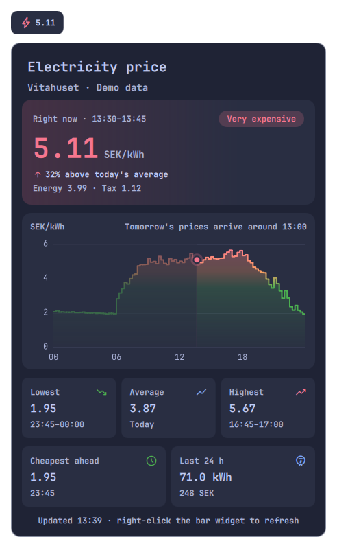
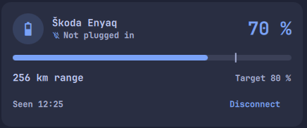

# duxtibber

Electricity prices in your [Dux Shell](https://github.com/duxlabs-dev/dux-shell) bar. The current price sits in the bar; click it for today's and tomorrow's prices, lowest/average/highest, the cheapest slot ahead, and your last 24 h of consumption.



Three data modes:

- **Tibber token:** your own home, prices and consumption.
- **Price area (no token):** free spot prices for SE1-SE4 or NO1-NO5.
- **Neither:** Tibber's demo data.

## Install (home-manager flakes)

Add the input and module:

```nix
# flake.nix
inputs.duxtibber = {
  url = "github:antonjah/duxtibber";
  inputs.nixpkgs.follows = "nixpkgs";
};
q
# in homeManagerConfiguration modules:
duxtibber.homeModules.default
```

Configure (all options except `enable` are optional):

```nix
programs.duxtibber = {
  enable = true;
  tokenFile = "~/.config/tibber/token"; # file with only your token, from developer.tibber.com
  priceArea = "SE3";                    # used when there is no token
  priceUnit = "minor";                  # "major" = SEK/kWh, "minor" = öre/kWh (øre, ct)
  showUnit = true;                      # "200 öre" instead of "200" in the bar and popup
  refreshMinutes = 15;                  # 5, 15, 30 or 60
};
```

Add the widget to your bar:

```nix
programs.dank-material-shell.settings.barConfigs = [{
  # ...
  rightWidgets = [ { id = "duxTibber"; enabled = true; } ];
}];
```

Rebuild, then enable the plugin once in Dux: Settings > Plugins > Scan > Tibber.

## Car (optional)

Shows your connected car's charge in the popup. Off by default.



```nix
programs.duxtibber.car = {
  enable = true;
  clientId = "...";   # from data-api.tibber.com/clients/manage
  # name = "Enyaq";   # which car, if you have several
};
```

Open the popup after rebuilding: it walks you through creating the Tibber API client and logging in once. The client secret goes in `~/.config/tibber/data-api-secret`.